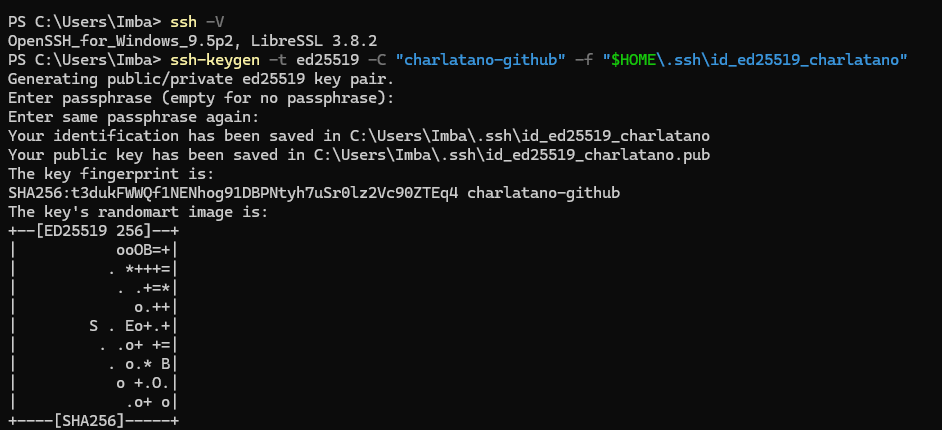
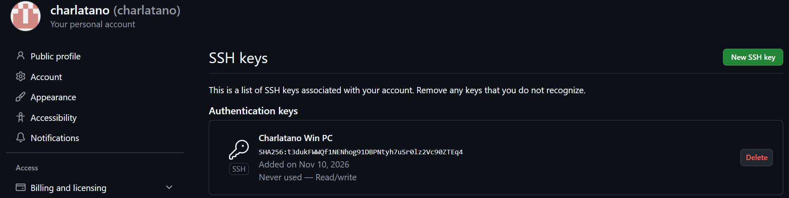
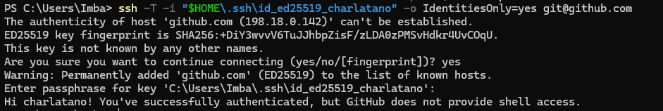
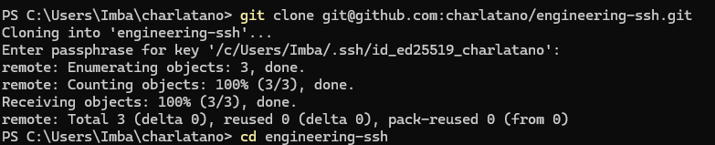

# ДЗ 3. Настройка SSH-доступа к GitHub

## Кейс 1. SSH-клиент и генерация ключей

Проверена версия SSH-клиента и создана отдельная пара ключей Ed25519:

```powershell
ssh -V
ssh-keygen -t ed25519 -C "charlatano-github" -f "$HOME\.ssh\id_ed25519_charlatano"
```

Приватный ключ защищён passphrase и хранится только на компьютере.
Приватный ключ и пароль в репозиторий не добавляются.



## Кейс 2. Добавление публичного ключа в GitHub

Содержимое файла `id_ed25519_charlatano.pub` добавлено в GitHub:
Settings → SSH and GPG keys → New SSH key.



## Кейс 3. Проверка SSH-подключения

```powershell
ssh -T -i "$HOME\.ssh\id_ed25519_charlatano" -o IdentitiesOnly=yes git@github.com
```

При первом подключении подтверждён ключ сервера.
Получено приветствие `Hi charlatano! You've successfully authenticated`.
Сообщение об отсутствии shell-доступа является нормальным для GitHub.



## Кейс 4. Работа с репозиторием по SSH

Репозиторий клонирован по SSH:

```powershell
git clone git@github.com:charlatano/engineering-ssh.git
cd engineering-ssh
```



Отчёт и скриншоты отправляются в этот репозиторий коммитом и `git push`.
Для Git-операций используется SSH-ключ, а не пароль аккаунта GitHub.
Passphrase при необходимости разблокирует локальный приватный ключ.

Ссылка на репозиторий: https://github.com/charlatano/engineering-ssh
